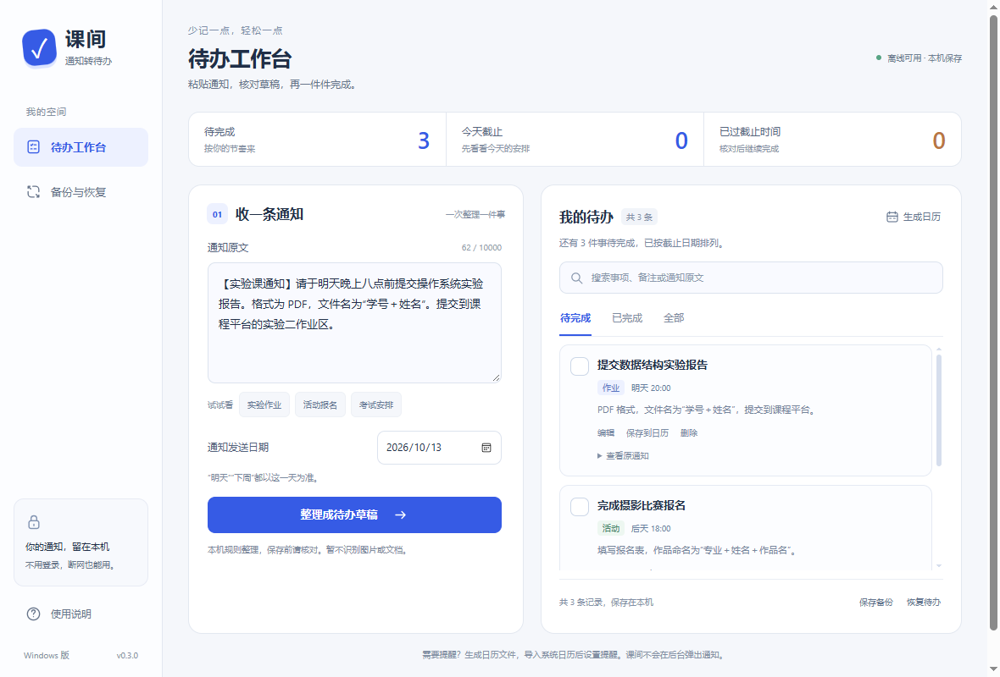
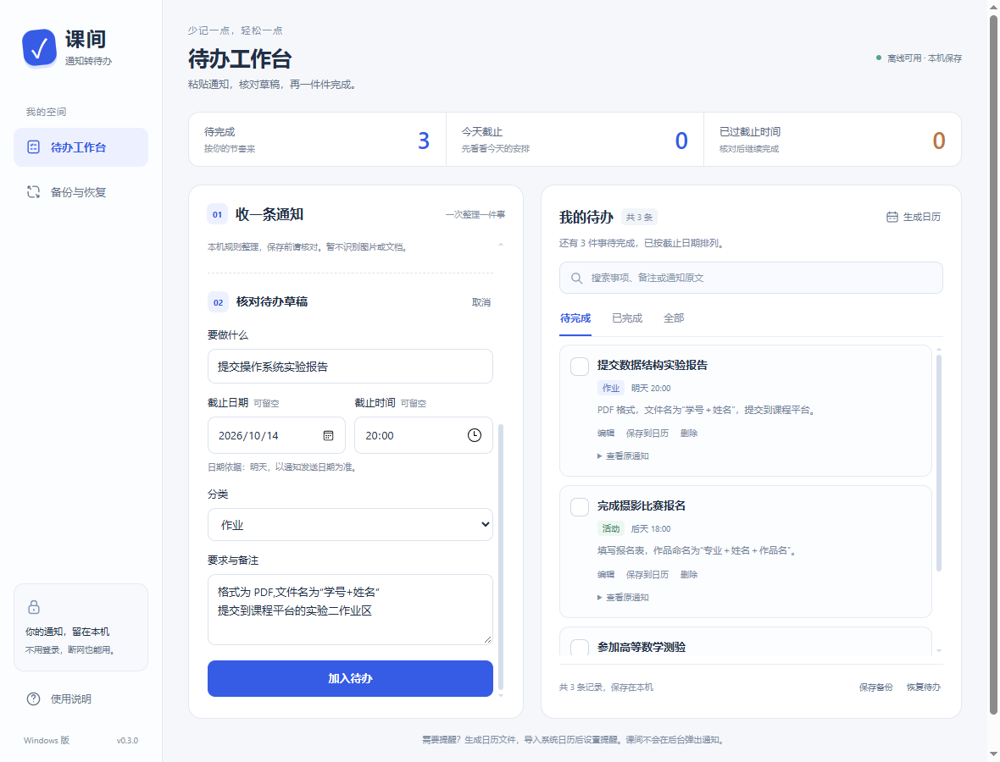
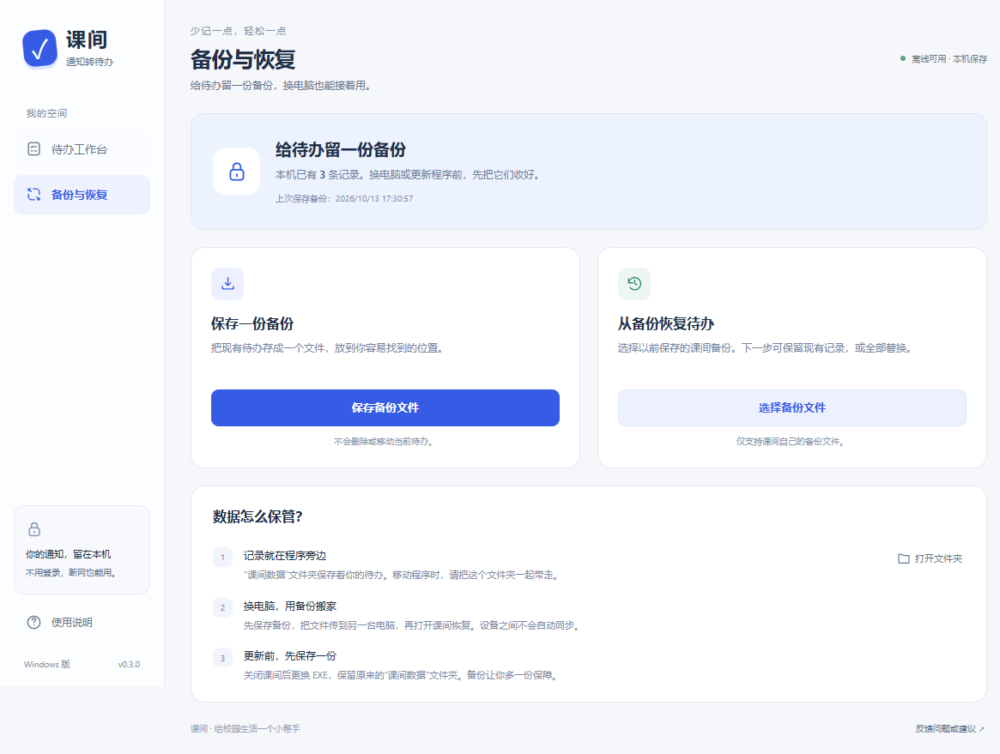

# 课间 · Windows 通知待办

把群里的文字通知粘贴进来，核对时间与要求，再保存为待办。

面向大学生的轻量桌面工具。**免安装、无需登录、离线可用**。通知在本机按规则整理，不调用付费接口，也不会上传你的待办。

**[下载 Windows 版](https://github.com/2267li/kejian/releases/latest)** · [使用说明](docs/desktop.md#使用与升级) · [反馈问题](https://github.com/2267li/kejian/issues)

当前 Windows 版本：**0.3.0**。现阶段集中完善 Windows 版。

## 看看界面

### 待办工作台

左边粘贴通知、核对草稿，右边查看和搜索待办。顶部能看到待完成、今天截止和已经逾期的事项数量。



<details>
<summary>查看草稿核对页面</summary>



</details>

### 备份与恢复

保存一份备份，或选择已有文件恢复；同一页说明数据存在哪里、怎样换电脑、怎样更新程序。



以上均为实际 EXE 界面截图，使用模拟通知，不包含个人待办。

## 下载后怎么用

1. 在 [下载页](https://github.com/2267li/kejian/releases/latest) 选择 `kejian-0.3.0-windows-x64.zip`。
2. 解压到可写入的文件夹，双击 **课间.exe**。
3. 粘贴通知，选对“通知发送日期”，点击“整理成待办草稿”。
4. 核对事项、日期、时间和要求，再加入待办。完成后勾选即可。

运行要求：**Windows 10/11 64 位、.NET Framework 4.7.2+、Microsoft Edge WebView2 Runtime**。若电脑提示缺少 WebView2，可从 [微软官网](https://developer.microsoft.com/microsoft-edge/webview2/) 安装。使用软件不需要 Node、pnpm 或微信开发者工具。

当前程序未做代码签名，Windows 可能显示“未知发布者”。下载包提供第三方组件说明，发布页同时提供 SHA-256 校验清单。

## 现在可以做什么

| 功能 | 使用方式 |
| --- | --- |
| 整理文字通知 | 提取事项、日期、时间、分类和要求，先生成草稿供你核对 |
| 管理待办 | 编辑、完成、恢复、删除；误删后可在提示中撤销 |
| 搜索与筛选 | 搜索事项、备注和原通知，切换待完成 / 已完成 / 全部 |
| 查看安排 | 按截止时间排序，日期不明确的事项保留为待定 |
| 备份与恢复 | 保存备份文件；恢复时选择保留现有待办或全部替换 |
| 导出日历 | 生成日历文件，自行导入日历软件并设置提醒 |

识别使用本地规则，**结果可能有误，保存前请核对**。暂不识别截图、PDF 或 Word，不支持自动同步、云端存储和后台提醒。待办超过一页时分页展示，每页最多 50 条。

## 数据与更新

程序第一次启动，会在 EXE 旁创建 **“课间数据”文件夹**。已保存的待办留在这里，关闭程序后仍会保留。

- **移动程序**：把 EXE 和“课间数据”文件夹一起移动。
- **换电脑**：先保存备份，把文件传到另一台电脑，再在课间中恢复。
- **更新版本**：先保存备份并关闭课间，再替换原位置的 EXE，保留“课间数据”文件夹。

不要把实际备份或“课间数据”上传到公开仓库。0.3.0 继续使用原有备份格式，可恢复旧版本课间备份。

## 开发与验证

桌面宿主使用 **C# WinForms + WebView2**，界面使用 HTML / CSS / JavaScript。页面、交互与文件桥接分开维护；通知识别复用 `src/core.js`。

```text
desktop/
  Program.cs                启动、单实例、便携数据目录与组件释放
  DesktopWindow.cs          原生窗口、文件保存和退出确认
  ui/index.html             桌面页面结构与文案
  ui/desktop.css            Windows 布局与样式
  ui/app.js                 待办、草稿、搜索、分页与备份交互
  ui/bridge.js              页面与原生文件保存通信
  dependency-lock.json      WebView2 SDK 版本及校验值
scripts/build-desktop.cjs    生成单 EXE 和分发 ZIP
tests/desktop.cjs            实际 EXE 的隔离回归测试
docs/                       使用、开发和验证记录
assets/previews/             README 使用的真实界面截图
```

本机开发目录为 `E:\Project\kejian`，缓存与测试资料放在项目的 `.cache`，统一使用 pnpm。克隆到其他环境时，可按需调整 `.npmrc` 和 `pnpm-workspace.yaml` 的缓存路径。

```powershell
pnpm run check:desktop   # 桌面脚本语法检查
pnpm run test:core       # 共享识别规则和通知样本测试
pnpm run build:desktop   # 生成 release/windows/v0.3.0
pnpm run test:desktop    # 实际启动 EXE 验证，需要可选 Playwright
```

构建需要 Windows 和本机 .NET Framework C# 编译器；首次构建从官方 NuGet 获取锁定版本的 WebView2 SDK，并校验摘要。后续复用缓存，不需要安装 Electron 或完整 .NET SDK。

EXE 自动化测试可通过 `KEJIAN_PLAYWRIGHT_MODULE` 指向已有 Playwright 模块。测试使用独立临时目录，不接触正常使用的数据。详细方法和覆盖范围见 [桌面开发说明](docs/desktop.md) 与 [0.3.0 验证记录](docs/qa/desktop-v0.3.0.md)。

原网页版和微信小程序代码保留在仓库中，本次未更新或发布。历史说明见 [文档目录](docs/README.md)。

## 反馈

请在 [Issues](https://github.com/2267li/kejian/issues) 描述操作步骤、预期结果和实际现象，可附上不含个人信息的截图。不要公开同学姓名、真实通知或备份文件。
