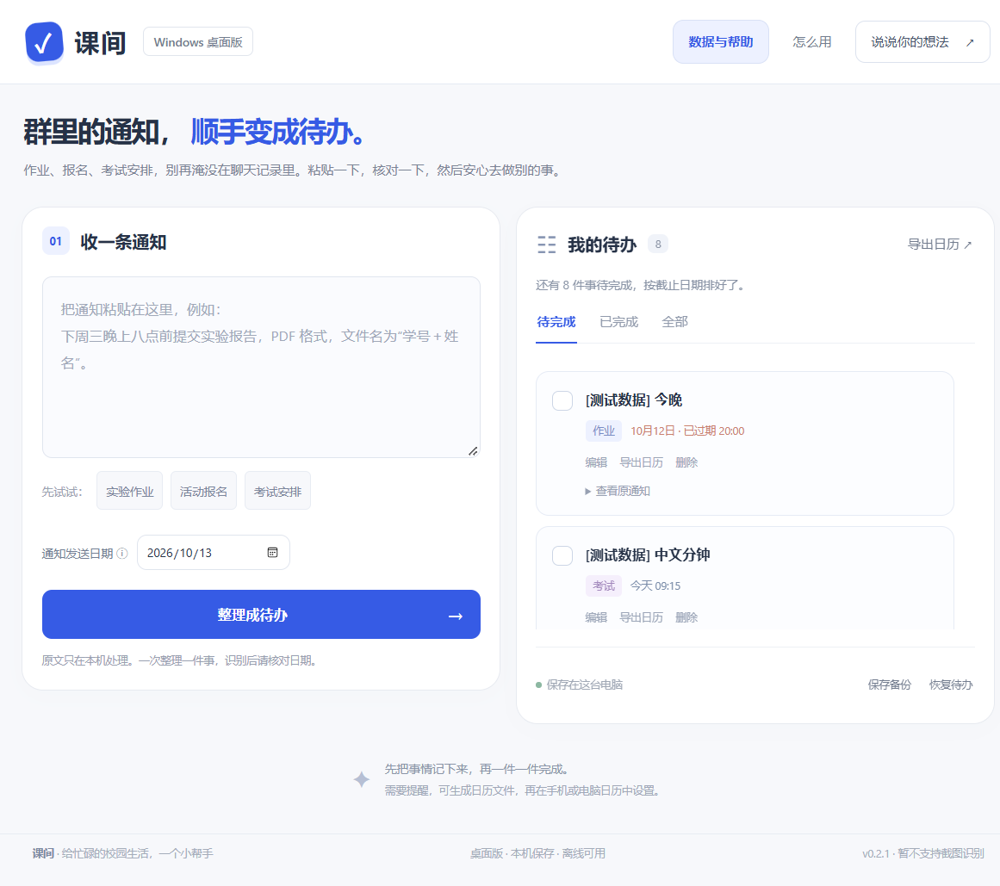

# 课间 · 通知转待办

面向大学生的免费通知待办工具，提供网页版、微信小程序开发版和 Windows 桌面版。粘贴通知，核对日期和要求，保存待办。

当前版本：**0.2.1**。支持添加到主屏幕、首次缓存后的离线使用和手动导入导出。通知识别使用本地规则，无付费 API、无账号，不上传通知。

**[下载 Windows 电脑端](https://github.com/2267li/kejian/releases/latest)** · [反馈问题或建议](https://github.com/2267li/kejian/issues)

第一次使用请下载发布页中的 `kejian-0.2.1-windows-x64.zip`，解压后双击“课间.exe”。适用于 Windows 10/11 64 位，需要 .NET Framework 4.7.2+ 和 WebView2 Runtime。详细要求见 [桌面版说明](docs/desktop.md)。



新增 **微信小程序开发版 0.1.0**，位于 `miniprogram/`。微信开发者工具导入项目根目录即可检查；当前尚无正式 AppID，未上传或发布。导入与发布步骤见 [微信小程序说明](docs/wechat.md)。基础功能免费，当前未接入广告、付费接口或云服务。

工程统一使用 pnpm，复用 E 盘已有依赖仓库，项目缓存与测试临时目录保存在 `.cache/`。小程序已修复模拟器白屏，通过编译、逻辑测试及实际微信模拟器交互验证，详见 [小程序 QA](docs/qa/wechat-v0.1.0.md)。本机运行 `pnpm run wechat:open` 打开开发者工具。

## 打开与使用

**Windows 桌面版**：双击 `release/windows/v0.2.1/课间.exe`；分发使用同目录的 `课间-Windows免安装版.zip`。本机运行环境已具备，无需安装。数据在 EXE 旁的“课间数据”文件夹，通过备份与其他端转移。详见 [桌面版说明](docs/desktop.md)。

在线使用：[打开课间](https://kejian-notice-todo.lih2267194.chatgpt.site)。部署记录在 `docs/deployment.md`。首次联网打开后，页尾显示“已就绪 · 断网也能用”表示离线缓存完成。

- 电脑：用 Edge / Chrome 打开网址，可通过“添加到桌面”安装。
- iPhone / iPad：Safari 打开网址 → 分享 → 添加到主屏幕。
- 安卓：用支持安装的浏览器打开网址 → 浏览器菜单 → 安装应用或添加到主屏幕。
- 手机底部可切换“收通知”“我的待办”，在“数据与帮助”中迁移数据。
- 换设备：原设备保存备份 → 传文件到新设备 → 恢复待办。默认合并；同 ID 以导入文件为准。选择替换全部时会再次确认。

电脑也可直接打开 `release/v0.2.1/课间-免费离线版.html`，但本地文件不能安装为 PWA。旧版本文件、不同浏览器和不同网址各自保存数据，需要导出导入迁移。

最新验证：40 条模拟通知 + 6 条高校公开通知摘编，旧版 25/46 符合预期，修复后 46/46。包含 17 条需要人工确认的样本，不代表全部自动识别。详见 [本轮报告](docs/qa/report-v0.2.1.md)。

## 目录约定

```text
kejian/
├── src/                  网页源码与共享识别逻辑，含离线脚本和图标
├── miniprogram/          原生微信页面与本地数据适配；core.js 由网页共享逻辑生成
├── desktop/              Windows 窗口、文件桥接、桌面样式与依赖锁定
├── project.config.json   微信开发者工具入口，当前为测试 AppID
├── scripts/              预览、构建、生成图标和 ZIP 打包
├── tests/                日期、日历、离线交互及跨设备迁移测试
├── docs/                 产品、开发、测试、用户说明、发布记录
├── assets/previews/      确认过的展示截图，含模拟数据
├── dist/                 网站发布文件；自动生成，不手改
├── release/v0.2.1/       HTML、试用 ZIP 和网站部署 ZIP；旧版本单独保留
├── release/wechat/       小程序开发包；不是已上线的小程序
├── release/windows/      Windows EXE、免安装 ZIP 和运行说明
├── .cache/               测试截图与构建归档等临时材料
├── netlify.toml          其他平台的构建与发布目录配置；无凭据
├── package.json          版本号与命令入口
└── CHANGELOG.md           变更记录
```

## 开发命令

Node.js 18+；使用产品只需浏览器。运行、构建、测试规则和打包无需 pnpm install。

```text
pnpm run dev           构建并预览 http://127.0.0.1:5173
pnpm run check         脚本语法检查
pnpm test              日期和日历测试
pnpm run build         生成 dist 网站与单文件 HTML
pnpm run package       生成试用 ZIP 和网站部署 ZIP
pnpm run test:browser  可选 Playwright：离线文件与网页全流程
pnpm run build:wechat 同步小程序识别逻辑
pnpm run check:wechat 小程序语法与 WXML/WXSS 编译检查
pnpm run test:transfer 网页与小程序备份格式双向验证
pnpm run build:desktop 生成 Windows EXE 与免安装 ZIP
pnpm run test:desktop  实际桌面程序的离线、备份和重启测试
pnpm run prepare:github 整理可公开的源码快照；仅本地准备，不上传
```

修改源码后重新构建。浏览器测试需要已有 Playwright 与浏览器，配置见 [开发说明](docs/development.md)。文档导航见 [文档目录](docs/README.md)。

备选网站托管方案的文件已备齐；Netlify 尚未部署或产生新网址，目前优先推进微信小程序。操作见 [迁移说明](docs/hosting-netlify.md)。

## 边界与成本

基础规则可能识别错误，保存前请核对。不支持截图识别、自动同步、后台推送或收费功能。日历提醒需导出后自行设置。

各端分别在本机保存记录；清理网页站点数据、微信小程序数据或桌面版数据文件夹会丢失记录，请定期备份。站点托管会产生正常网页访问请求，产品不上传通知或自动收集使用反馈。

本轮使用现有 Sites 资格，未购买服务、域名或 API。官方公测政策为符合条件的套餐包含 Sites，受套餐、地区、工作区和额度限制，不承诺永久免费或无限量。详情见 [官方价格说明](https://learn.chatgpt.com/docs/pricing)。

## 维护约定

网页修改 src，小程序修改 miniprogram；共享识别逻辑只修改 src/core.js 后运行 build:wechat，不直接修改生成的 miniprogram/utils/core.js、dist 或 release。功能变化同步更新文档、测试与 CHANGELOG。发布前运行相关检查；不要将真实通知、账号、密钥或日志提交到源码仓库。
